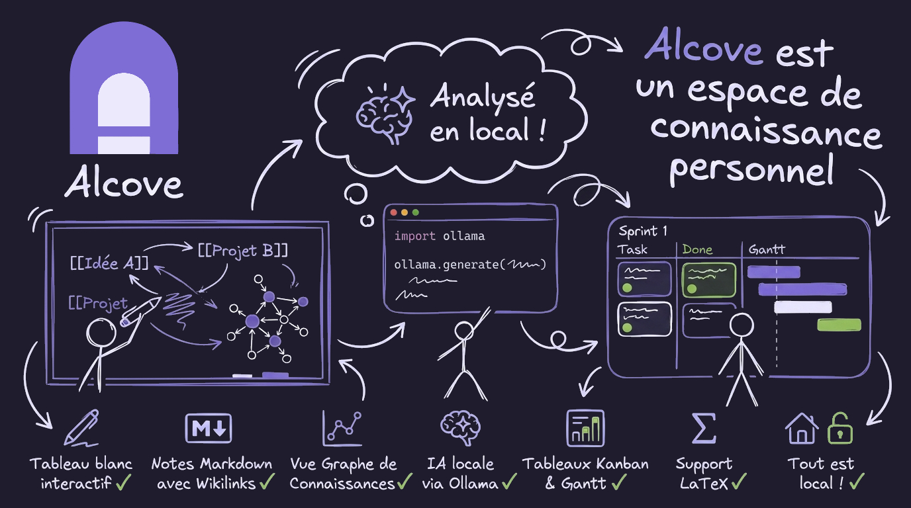

[](https://github.com/KoroKira/alcove/actions/workflows/ci.yml)
[](LICENSE)
[](https://ko-fi.com/guilhemdl)

**Alcove** est un espace de travail personnel open source : documents Markdown,
canvas Excalidraw, Kanban, Gantt et LaTeX, reliés par la recherche et les
wikilinks. L'assistant utilise Ollama sur la machine configurée par l'opérateur.
En hébergement, les notes et les requêtes IA transitent par votre serveur Alcove.

Initialement dérivé de [pad.ws](https://github.com/coderamp-labs/pad.ws), Alcove
conserve l'historique et l'attribution du projet d'origine.

## Choisir son installation

| Besoin | Procédure |
|---|---|
| Essayer sur son ordinateur, sans compte | [Docker local](#essayer-en-local-avec-docker) |
| Développer avec rechargement automatique | [Mode développement](SETUP.md#développement-local) |
| Héberger avec HTTPS et comptes privés | [Guide serveur](SETUP.md#serveur-https-avec-comptes) |
| Relier un assistant à ses pads | [Guide MCP](docs/MCP.md) |
| Mettre à jour, sauvegarder et revenir en arrière | [Exploitation](SETUP.md#mise-à-jour-et-retour-en-arrière) |

Le mode local contourne l'authentification : il reste limité à votre ordinateur.
Pour une URL publique ou plusieurs utilisateurs, utiliser le guide serveur.
`docker-compose.yml` et `.env.template` sont des fichiers historiques avec
Coder, conservés pour les installations existantes; ils ne sont pas le point
de départ recommandé.

## Essayer en local avec Docker

Installer et démarrer Docker Desktop (ou Docker Engine avec Compose v2 sous
Linux), puis :

```sh
git clone https://github.com/KoroKira/alcove.git
cd alcove
docker compose -f docker-compose.friends.yml up -d --build
```

Ouvrir [http://localhost:8000](http://localhost:8000). La connexion au compte
local est automatique. L'application, PostgreSQL, Redis et Ollama tournent en
conteneurs. Le premier téléchargement du modèle IA peut durer plusieurs
minutes; les pads restent utilisables pendant ce temps.

Sur macOS et Windows, les lanceurs `scripts/start-for-friends.command` et
`scripts/start-for-friends.bat` exécutent ce même parcours.

```sh
# Voir l'état et les erreurs éventuelles
docker compose -f docker-compose.friends.yml ps
docker compose -f docker-compose.friends.yml logs --tail=80 pad

# Arrêter sans effacer les données
docker compose -f docker-compose.friends.yml stop
```

Les bases et les modèles sont conservés dans les volumes Docker; les fichiers
synchronisés sont sous `./pads`. Un export ZIP des pads facilite leur transfert,
mais ne remplace pas une sauvegarde complète de l'installation. Ne pas utiliser
`down -v` pour une mise à jour : cette option supprime les volumes.

## Ce qu'on peut faire

| Domaine | Fonctions |
|---|---|
| Pads | Canvas Excalidraw, document Markdown avec aperçu, Kanban, Gantt, LaTeX |
| Organisation | Dossiers, tags, favoris, onglets, note du jour, dashboard |
| Connaissances | `[[wikilinks]]`, `![[transclusion]]`, graphe, recherche titres/contenu |
| Écriture | Callouts, formules KaTeX, images, table des matières |
| Données | Autosauvegarde, historique de révisions, corbeille, export, import Obsidian |
| IA | Chat contextuel, résumé, tags, liens suggérés, flashcards, quiz, recherche RAG |
| Navigation | Palette de commandes, raccourcis, thèmes clair/sombre, interface installable PWA |

Les sauvegardes doivent être vérifiées avant toute restauration. L'installation
PWA n'est pas une sauvegarde et ne garantit pas que toutes les fonctions
marchent hors connexion. La compilation LaTeX dépend du moteur configuré;
l'historique, les importations et le RAG doivent être vérifiés avec des données
de test sur votre installation.

## IA avec Ollama

Le navigateur passe par `/api/ai/ollama` sur son serveur Alcove. Il n'a pas besoin
d'un Ollama local ni de modifier des autorisations CORS. `OLLAMA_URL` est
l'adresse vue par le **backend**, pas par votre navigateur.

Dans les stacks Docker local et serveur, Ollama reste accessible sur le réseau
interne. Installer explicitement le modèle de chat et celui des embeddings pour
le RAG :

```sh
# Pour la stack locale; voir SETUP.md pour la commande serveur
docker compose -f docker-compose.friends.yml exec ollama ollama pull llama3.2
docker compose -f docker-compose.friends.yml exec ollama ollama pull nomic-embed-text
```

Le chat fonctionne sans le modèle d'embeddings. La première indexation RAG
nécessite que ce dernier soit présent et que le serveur ait assez de mémoire.

## Navigation et accessibilité

Les actions fréquentes sont accessibles depuis les boutons et la palette de
commandes. Les raccourcis utilisent `Cmd` sur macOS et `Ctrl` ailleurs.

| Raccourci | Action |
|---|---|
| `Cmd/Ctrl + K` | Palette de commandes |
| `Cmd/Ctrl + N` | Nouveau canvas |
| `Cmd/Ctrl + Shift + F` | Recherche globale |
| `Cmd/Ctrl + D` | Dashboard |
| `Cmd/Ctrl + G` | Graphe de connaissances |
| `Cmd/Ctrl + J` | Note du jour |

Les contrôles au clavier, le focus visible, la lisibilité et les messages de
sauvegarde font partie des parcours à vérifier lors d'une mise à jour. Signaler
les problèmes d'accès avec le navigateur, le type de pad et les étapes de
reproduction, sans joindre de contenu privé.

## Développement et contribution

Frontend React 19 / TypeScript / Vite, backend FastAPI / SQLAlchemy,
PostgreSQL 16, Redis, authentification OIDC avec Keycloak pour l'hébergement.
Le terminal optionnel hérité de Coder/ttyd n'est pas activé par la stack serveur
recommandée.

Voir [SETUP.md](SETUP.md), [CONTRIBUTING.md](CONTRIBUTING.md),
[SECURITY.md](SECURITY.md) et [l'administration des comptes](docs/ACCOUNT_ADMINISTRATION.md).
Les mots de passe, fichiers `.env` et clés MCP ne doivent jamais être commités.

## Crédits

- [pad.ws](https://github.com/coderamp-labs/pad.ws) — projet d'origine
- [Excalidraw](https://github.com/excalidraw/excalidraw) — moteur de canvas
- [Ollama](https://ollama.com) — inférence locale
- [Alexandrie](https://github.com/Smaug6739/Alexandrie) — inspiration
